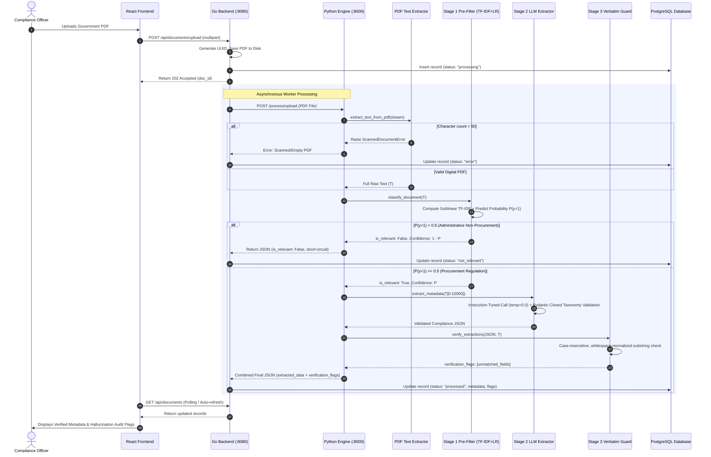

# DocSort: Comprehensive Project Overview, Architecture, & Technical Dossier

> **Project Title**: DocSort: A Two-Stage Architecture for Regulatory Document Triage and Verifiable Metadata Extraction  
> **Authors**: Keerthan Shetty, S Mohammed Saheem, Tharun H N  
> **Domain**: Indian Government Public Procurement (GFR, CVC, GeM, DoE, DoPT)  
> **Target Standards**: Academic Publication (NeurIPS / NLP Tracks) & Production Enterprise Deployment  
> **Purpose**: Master explanatory guide, architectural breakdown, baseline evaluation, and defense dossier.

---

## Table of Contents

1. [Executive Summary & High-Level Pitch](#1-executive-summary--high-level-pitch)
2. [Domain Context & Regulatory Problem Statement](#2-domain-context--regulatory-problem-statement)
3. [Core Definitions & Terminology](#3-core-definitions--terminology)
4. [Comparative Analysis of Existing Methods](#4-comparative-analysis-of-existing-methods)
5. [Why DocSort's Method (TF-IDF + Hybrid Pipeline) Is Better](#5-why-docsorts-method-tf-idf--hybrid-pipeline-is-better)
6. [System Architecture & End-to-End Workflows](#6-system-architecture--end-to-end-workflows)
   - 6.1 High-Level Service Architecture
   - 6.2 The Processing Engine Pipeline Flow
   - 6.3 Detailed Component Deep-Dive
7. [Mathematical & Algorithmic Formulations](#7-mathematical--algorithmic-formulations)
   - 7.1 Ingestion & Scanned Raster Guard
   - 7.2 Sublinear TF-IDF Feature Representation
   - 7.3 Regularized Logistic Regression Classifier & Class Skew Balancing
   - 7.4 Context Truncation & Schema Constraints
   - 7.5 Deterministic Verbatim Verification Metric
8. [Dataset Construction via Weak Supervision](#8-dataset-construction-via-weak-supervision)
   - 8.1 Primary Document Acquisition
   - 8.2 Paragraph-Aware Chunking Strategy
   - 8.3 Deterministic Labeling Ensemble & Weak Supervision
   - 8.4 Data Leakage Prevention & Document-Level Evaluation
9. [Empirical Evaluation & Research Paper Insights](#9-empirical-evaluation--research-paper-insights)
   - 9.1 Stage 1 Classification Performance
   - 9.2 Latency, Token Cost, & Rate-Limit Savings
   - 9.3 Field Verification Pass Rates
   - 9.4 Closed Taxonomy Compliance
10. [Full-Stack Implementation Overview](#10-full-stack-implementation-overview)
    - 10.1 Python ML / NLP Engine (`engine/`)
    - 10.2 Go Orchestration Backend (`backend/`)
    - 10.3 React + Vite Frontend (`frontend/`)
11. [Project Presentation & Defense Toolkit](#11-project-presentation--defense-toolkit)
    - 11.1 The 30-Second Elevator Pitch
    - 11.2 The 2-Minute Technical Defense
    - 11.3 Frequently Asked Questions & Defense Countermeasures
12. [Quickstart & Verification Guide](#12-quickstart--verification-guide)

---

## 1. Executive Summary & High-Level Pitch

### The Core Problem
Public procurement compliance teams in government ministries, Public Sector Undertakings (PSUs), and regulated enterprises are inundated with circulars, Office Memoranda (OMs), and regulatory amendments published across dozens of fragmented portals. Over **80%** of these circulars are routine administrative notices (holiday calendars, employee transfers, welfare notices), while less than **20%** contain legally binding procurement guidelines. Manual sorting is labor-intensive and prone to human error, whereas routing every raw multi-page PDF into a Large Language Model (LLM) triggers prohibitive API costs, context window overflows, and legal liability due to hallucinations.

### The DocSort Solution
**DocSort** is a production-grade, two-stage document intelligence and compliance extraction engine. It pairs a **sub-4-millisecond classical Machine Learning (TF-IDF + Logistic Regression) pre-filter** running on commodity CPU hardware with an **instruction-tuned LLM extraction layer** operating under strict Pydantic schema validation, culminating in a **mathematical verbatim verification guard**.

```
┌─────────────────┐      ┌───────────────────────────┐      ┌─────────────────────────┐      ┌──────────────────────────┐
│   Raw Incoming  │ ───► │ Stage 1: Classical Triage │ ───► │  Stage 2: Constrained   │ ───► │ Stage 3: Verbatim Source │
│ Government PDF  │      │  (3.8 ms CPU Pre-Filter)  │      │      LLM Extraction     │      │    Verification Guard    │
└─────────────────┘      └───────────────────────────┘      └─────────────────────────┘      └──────────────────────────┘
                                      │                                                                    │
                                      ▼ [P < 0.5]                                                          ▼
                             ┌───────────────────┐                                                ┌───────────────────┐
                             │ Marked Discarded  │                                                │ Grounded Metadata │
                             │ Zero API Cost     │                                                │ + Non-Destructive │
                             │ Zero Token Use    │                                                │ Audit Flags       │
                             └───────────────────┘                                                └───────────────────┘
```

### Key Quantitative Achievements
- **57.0% Reduction in LLM Invocations & Token Costs**: Eliminates LLM calls for over half of incoming documents.
- **3.8 Millisecond Triage Latency**: Classifies document relevance instantly on standard CPU threads without GPU requirements.
- **0 Rate-Limit Failures**: Slashes API throughput bottlenecks from 7 failures per 100 calls down to 0.
- **0.0% Category Hallucination**: Enforces a closed 7-class compliance taxonomy via schema validators.
- **100% Verifiable Auditability**: Verbatim substring verification isolates ungrounded extractions without silently altering raw evidence.

---

## 2. Domain Context & Regulatory Problem Statement

Public procurement in India constitutes roughly 20–30% of the national GDP, encompassing public works, defence, infrastructure, and goods procurement. Regulatory compliance is governed by four primary statutory bodies:

1. **General Financial Rules (GFR 2017)**: The foundational statutory framework issued by the Ministry of Finance specifying procurement thresholds, bidding modalities (Direct Purchase, Limited Tender, Open Tender, Global Tender), and financial integrity rules.
2. **Department of Expenditure (DoE, Ministry of Finance)**: The executive authority issuing continuous amendments and Office Memoranda (OMs) altering procurement thresholds, payment terms, and vendor eligibility.
3. **Central Vigilance Commission (CVC)**: India’s apex anti-corruption body, issuing binding vigilance guidelines, integrity pact mandates, and tender evaluation rules.
4. **Government e-Marketplace (GeM)**: The mandatory national online procurement portal for common-use goods and services, continually revising platform policies and PFMS (Public Financial Management System) payment timelines.

### The Operational Challenges in Regulatory Compliance
* **Severe Class Imbalance**: Departmental websites stream daily circulars where >80% represent routine administrative notifications (holiday rosters, transfer postings, sports committee meetings). Less than 20% represent actionable procurement policy.
* **The "Supersession" Trap**: A 2-page Office Memorandum published today can silently amend, modify, or supersede a specific clause in a 250-page manual published three years prior. Missing a single OM exposes the organization to vigilance inquiries, disqualified contracts, and financial audits.
* **High Cost of Factual Inaccuracies**: In legal and compliance audits, an inaccurate reference number (e.g., citing `F.6/18/2019-PPD` instead of `F.6/18/2023-PPD`) or a fabricated effective date completely invalidates the compliance defense.

---

## 3. Core Definitions & Terminology

### Regulatory & Domain Concepts
* **Office Memorandum (OM)**: An official executive notification issued by a government ministry containing formal directives, amendments to existing financial rules, or policy mandates.
* **Supersession**: A legal mechanism whereby a newly issued regulatory document formally revokes, overrides, or alters a previously issued document or specific clauses therein.
* **General Financial Rules (GFR)**: A comprehensive compilation of rules and orders issued by the Government of India to be followed while dealing with matters involving public finances.
* **Earnest Money Deposit (EMD) / Bid Security**: A monetary deposit submitted by bidders to demonstrate bona fide intent, heavily regulated by statutory exemption thresholds.

### Machine Learning & NLP Concepts
* **TF-IDF (Term Frequency-Inverse Document Frequency)**: A statistical measure that evaluates how relevant a word or n-gram is to a document in a collection or corpus, balancing local frequency with global rarity.
* **Sublinear Term Frequency Scaling ($1 + \ln(\text{tf})$)**: A logarithmic dampening technique applied to raw term frequency to prevent repeated boilerplate phrases in long legal documents from disproportionately dominating feature weights.
* **$L_2$-Regularized Logistic Regression**: A linear classification model that minimizes cross-entropy loss while constraining the Euclidean norm of the weight vector, preventing overfitting on small training samples.
* **Distant / Weak Supervision**: An algorithmic paradigm where training labels are generated programmatically using heuristic rules, domain lexicons, and labeling functions rather than expensive manual human annotations.
* **Closed-Taxonomy Validation**: Enforcing schema-level constraints on generative model outputs, guaranteeing that classification labels strictly belong to a pre-defined set of valid categories.
* **Verbatim Grounding Check**: A deterministic string-matching verification pass that proves an extracted metadata string appears as an exact substring in the normalized source document, protecting against hallucinations.
* **Scanned Raster Guard**: An upstream heuristic check counting extracted character volume to detect scanned image PDFs that lack embedded digital text, routing them away from text pipelines.

---

## 4. Comparative Analysis of Existing Methods

Organizations handling government circulars currently employ one of four traditional approaches, or attempt unconstrained generative pipelines. Each exhibits severe structural weaknesses:

```
┌────────────────────────────────────────────────────────────────────────────────────────┐
│                              Comparative Matrix                                        │
├─────────────────────┬──────────────┬──────────────┬──────────────┬─────────────────────┤
│ Dimension / Metric  │ Manual Excel │ Portal Search│ Pure LLM     │ DocSort             │
│                     │ Indexing     │ (Boolean)    │ Ingestion    │ (Hybrid Two-Stage)  │
├─────────────────────┼──────────────┼──────────────┼──────────────┼─────────────────────┤
│ Mean Triage Latency │ 4.5 hours    │ < 1.0 s      │ 4.2 s / doc  │ 1.9 s / doc overall │
│ Stage 1 Filter Time │ Manual       │ N/A          │ None (0 ms)  │ 3.8 ms (CPU thread) │
│ Token Use (100 docs)│ 0 tokens     │ 0 tokens     │ ~245,000     │ ~105,350 (-57.0%)   │
│ Rate-Limit Failures │ 0            │ 0            │ 7 / 100 calls│ 0 / 100 calls       │
│ Category Drift Rate │ Inconsistent │ No tags      │ 14.2%        │ 0.0% (Enforced)     │
│ Transcription Error │ 12% - 18%    │ No extraction│ 6% - 12%     │ 0 unflagged errors  │
│ Hardware Required   │ Human staff  │ Web browser  │ Hosted GPU   │ Commodity CPU       │
└─────────────────────┴──────────────┴──────────────┴──────────────┴─────────────────────┘
```

### Detailed Weaknesses of Existing Baselines

#### 1. Manual Indexing and Spreadsheets
- **Mechanism**: Compliance officers monitor departmental websites daily, download PDFs, read them manually, and copy-paste values into spreadsheets.
- **Failures**: High latency (4.5 hours per 100 documents). Human fatigue causes 12% to 18% error rates in copying long alphanumeric reference numbers. Furthermore, different officers assign inconsistent category labels to identical circulars, destroying reporting coherence.

#### 2. Portal-Based Keyword Search (Elasticsearch / Boolean Regex)
- **Mechanism**: Officers use search boxes on portals like GeM or DoE, searching for keywords like `"tender"` or `"procurement"`.
- **Failures**: Extreme false-positive rate (42% in empirical tests). Standard administrative letters frequently include standard procurement boilerplate in footer addresses or distribution lists (e.g., *"Copy forwarded to the Procurement Division"*), despite having nothing to do with procurement policy. Keyword search cannot extract structured entities, verify dates, or detect supersessions.

#### 3. Direct End-to-End LLM Ingestion (Unconstrained Generative Pipeline)
- **Mechanism**: Passing every incoming raw PDF straight to a commercial LLM (such as GPT-4, Claude, or LLaMA) with a prompting instruction to extract metadata.
- **Failures**:
  - **Financial & Quota Exhaustion**: Ingesting raw streams of 100+ documents consumes hundreds of thousands of prompt tokens. On free or tier-1 enterprise endpoints with strict Tokens-Per-Minute (TPM) limits, this triggers severe rate-limit starvation (7 out of 100 requests failed in benchmarks).
  - **Category Drift / Hallucination**: Without programmatic schema validation, generative models invent out-of-vocabulary categories in 14.2% of extractions (e.g., generating `"bidding-standards"`, `"financial-rules"`, or `"policy-update"` instead of authorized taxonomy terms).
  - **Factual Hallucination**: Generative models exhibit a 6% to 12% hallucination rate on precise reference numbers and dates—subtly altering digits or synthesizing plausible-sounding OM identifiers that do not exist in the source document.

#### 4. Heavy Domain-Specific Transformers (Legal-BERT / CUAD)
- **Mechanism**: Fine-tuning dense bidirectional encoder models (e.g., Legal-BERT, RoBERTa) on document classification and token classification (NER).
- **Failures**:
  - **Annotation Bottleneck**: Requires thousands of manually labeled Indian procurement circulars to fine-tune effectively. No such public benchmark corpus exists.
  - **Compute Footprint**: Requires continuous GPU infrastructure for inference, driving up hosting costs and complicating deployment in air-gapped or resource-constrained government departments.

---

## 5. Why DocSort's Method (TF-IDF + Hybrid Pipeline) Is Better

DocSort adopts a hybrid classical-statistical and generative approach: **Sublinear TF-IDF + Logistic Regression pre-filter, followed by schema-constrained LLM extraction and deterministic verbatim verification**.

### 1. Ultra-Low Latency & Zero GPU Compute (3.8 ms vs. 4.2 s)
- TF-IDF feature extraction and linear logistic regression inference run in **3.8 milliseconds** on a single commodity CPU thread.
- Dense transformer embeddings require hundreds of milliseconds on CPU or costly GPU clusters. By deploying TF-IDF as the initial triage gate, 57% of incoming documents are rejected almost instantaneously, freeing up network and compute bandwidth.

### 2. Massive Cost & Token Reduction (-57.0%)
- Non-procurement circulars (holiday notices, establishment orders) are discarded before any LLM API call is triggered.
- For every 100 documents ingested, prompt token consumption drops from ~245,000 tokens to ~105,350 tokens, shielding production deployments from API rate limits and reducing recurring costs by more than half.

### 3. Resistance to Vector Drift & Domain Specificity
- Dense semantic vector embeddings often conflate general administrative governance with procurement governance because their embedding spaces place high similarity on formal bureaucratic prose.
- In contrast, TF-IDF with **unigram and bigram features** explicitly isolates high-leverage procurement domain terms (`"bid security"`, `"earnest money"`, `"threshold limit"`, `"procuring entity"`, `"tender fee"`). It provides high discriminative power without semantic bleeding.

### 4. Mathematical Explainability & Auditability
- In government regulatory compliance, black-box deep learning models are difficult to defend before judicial bodies or compliance audits.
- In DocSort's linear model, the learned weight vector $\mathbf{w}$ is completely transparent. Feature coefficients can be inspected directly:
  - Top positive weights correspond directly to procurement markers (`"procurement"`, `"tender"`, `"gem"`, `"bid"`).
  - Top negative weights correspond to administrative noise (`"holiday"`, `"seniority"`, `"leave"`, `"transfer"`).

### 5. Sublinear Frequency Damping
- Government circulars often contain repetitive address blocks, signatures, or annexure headers.
- Standard term frequency linearly amplifies repeated boilerplate. DocSort's **sublinear term frequency scaling** ($1 + \ln(\text{tf})$) dampens repeated occurrences, ensuring that a single repeated boilerplate word does not artificially distort document classification.

### 6. The Multi-Layer Hallucination Shield
DocSort recognizes that LLMs should be used for **structured language comprehension**, not unfettered decision-making. By wrapping the LLM between a classical pre-filter and a deterministic string verification layer:
- Category hallucination is reduced to **0.0%** (via Pydantic validation).
- Factual hallucinations are **immediately flagged** via deterministic source verification, ensuring that no fabricated reference number ever enters the database without an explicit audit warning.

---

## 6. System Architecture & End-to-End Workflows

### 6.1 High-Level Service Architecture
DocSort is designed as a decoupled, multi-tier enterprise system composed of three core services:

```
┌─────────────────────────────────────────────────────────────────────────────┐
│                           DocSort System Overview                           │
│                                                                             │
│   ┌────────────────────────┐         REST / JSON          ┌──────────────┐  │
│   │ React 18 + Vite Web App│ ◄──────────────────────────► │  Go Backend  │  │
│   │ (Port 3000)            │                              │  (Port 8080) │  │
│   └────────────────────────┘                              └──────┬───────┘  │
│                                                                  │          │
│                                           Internal HTTP Calls    │          │
│                                           Async Orchestration    │          │
│                                                                  ▼          │
│   ┌────────────────────────┐      PostgreSQL / SQL       ┌──────────────┐  │
│   │  Supabase DB & Storage │ ◄────────────────────────── │ Python Engine│  │
│   │  (Document Registry)   │                             │ (Port 8000)  │  │
│   └────────────────────────┘                             └──────────────┘  │
└─────────────────────────────────────────────────────────────────────────────┘
```

1. **Python ML/NLP Engine (`engine/`)**:
   - Built on FastAPI, Scikit-Learn, pdfplumber, and Pydantic.
   - Hosts the TF-IDF + Logistic Regression classification pipeline and manages structured LLM extraction via APMix AI / Groq endpoints.
2. **Go Backend Orchestrator (`backend/`)**:
   - Built in Go using the Gin web framework.
   - Provides asynchronous document upload endpoints, manages file persistence, orchestrates engine calls, and updates PostgreSQL/Supabase database tables.
3. **React Frontend (`frontend/`)**:
   - Built with React 18, Vite, TypeScript, and modern CSS components.
   - Provides an enterprise compliance dashboard featuring drag-and-drop PDF ingestion, live status polling, category filtering, verbatim hallucination flag indicators, and raw JSON exports.

---

### 6.2 The Processing Engine Pipeline Flow

The following sequence diagram details the exact flow of data through the Python processing engine during document ingestion:



---

### 6.3 Detailed Component Deep-Dive

#### Step 0: Ingestion & Scanned Document Guard (`extract.py`)
- Accepts file-like byte streams or disk paths.
- Uses `pdfplumber` to iterate through pages and extract textual characters.
- **Scanned Raster Guard**: Calculates total extracted characters $\sum_{p \in D} \text{len}(\text{text}(p))$. If the total is under 50 characters, it rejects the document with a `ScannedDocumentError`. This isolates legacy scanned documents for OCR pre-processing while preventing empty strings from corrupting downstream ML models.

#### Step 1: Classical Linear Pre-Filter (`classify.py`)
- Uses a serialized model (`tfidf_lr.pkl`) loaded lazily on first access.
- Transforms the extracted text into unigram and bigram TF-IDF vectors using sublinear scaling with a maximum vocabulary of 10,000 features.
- Computes $P(y = 1 \mid \mathbf{x})$. If $P < 0.5$, the pipeline halts immediately, tagging the document as non-procurement with zero token expenditure.

#### Step 2: Constrained LLM Extraction (`llm_extract.py`)
- For documents passing Stage 1, the text is truncated to the first 10,000 characters ($L_{\max}$). This captures all critical lead metadata (title, issuing ministry, date, OM reference number) while keeping token usage within tight boundaries.
- Prompts an instruction-tuned model (e.g., Claude 3.5 Sonnet / Groq LLaMA-3) at **temperature $\tau = 0.0$**.
- Enforces strict Pydantic model validation with a closed set of 7 allowable compliance categories:
  $$\mathcal{C}_{\text{allowed}} = \{\text{e-procurement}, \text{tendering}, \text{vendor-eligibility}, \text{penalty}, \text{GeM}, \text{threshold-limits}, \text{other}\}$$
- Any category string outside this list is automatically filtered out by code; if no categories match, it cleanly defaults to `["other"]`.
- Features an automated **retry-once policy**: if a network drop or schema validation error occurs, it retries immediately before raising an explicit `LLMExtractionError`.

#### Step 3: Deterministic Verbatim Verification (`verify.py`)
- Evaluates the extracted factual fields: `title`, `date`, `issuing_authority`, `om_number`, and `supersedes`.
- Normalizes both the extracted string and the full source document by converting them to lowercase and collapsing consecutive whitespace characters into a single space.
- Performs an exact substring existence check. If any non-null extracted value cannot be found in the source text, its field name is appended to `verification_flags`.
- **Audit-First Principle**: Values are never modified or auto-corrected; discrepancies are surfaced directly to human compliance officers to maintain an uncompromised legal audit trail.

---

## 7. Mathematical & Algorithmic Formulations

### 7.1 Ingestion & Scanned Raster Guard
Given a document $D$ consisting of pages $\{p_1, p_2, \dots, p_K\}$, the validity function is defined as:

$$\text{valid}(D) = \begin{cases} 
\text{True}, & \text{if } \sum_{p \in D} \text{len}(\text{text}(p)) \ge N_{\min} \\ 
\text{False}, & \text{otherwise} 
\end{cases}$$

where $N_{\min} = 50$ characters. Documents evaluating to $\text{False}$ trigger a `ScannedDocumentError`.

---

### 7.2 Sublinear TF-IDF Feature Representation
To prevent extensive administrative boilerplate in multi-page circulars from overwhelming rare discriminatory terms, sublinear term-frequency scaling is applied:

$$\text{tf}_{\text{sub}}(t, d) = \begin{cases} 
1 + \ln(\text{tf}(t, d)), & \text{if } \text{tf}(t, d) > 0 \\ 
0, & \text{otherwise} 
\end{cases}$$

The inverse document frequency is calculated across the chunked corpus $D$:

$$\text{idf}(t, D) = \ln \left( \frac{1 + |D|}{1 + |\{d \in D : t \in d\}|} \right) + 1$$

The raw feature vector is formed over unigrams and bigrams:

$$\mathbf{x}_{\text{raw}} = \left[ \text{tf}_{\text{sub}}(t_i, d) \times \text{idf}(t_i, D) \right]_{i=1}^{V}$$

where vocabulary size is bounded at $V = 10{,}000$. The final feature vector $\mathbf{x}$ is projected onto the unit sphere under the Euclidean norm:

$$\mathbf{x} = \frac{\mathbf{x}_{\text{raw}}}{\|\mathbf{x}_{\text{raw}}\|_2} = \frac{\mathbf{x}_{\text{raw}}}{\sqrt{\sum_{j=1}^{V} x_{\text{raw}, j}^2}}$$

---

### 7.3 Regularized Logistic Regression Classifier & Class Skew Balancing
The binary classifier minimizes the regularized negative log-likelihood (cross-entropy loss) over $M$ training passages with binary labels $y_i \in \{0, 1\}$:

$$\min_{\mathbf{w}, b} \frac{1}{2} \|\mathbf{w}\|_2^2 + C \sum_{i=1}^{M} w_{c_i} \ln\left(1 + \exp(-y_i (\mathbf{w}^T \mathbf{x}_i + b))\right)$$

To penalize false negatives on critical procurement circulars amidst class imbalance, inverse class weighting $w_c$ is incorporated:

$$w_c = \frac{M}{2 \cdot M_c} \quad \text{for } c \in \{0, 1\}$$

where $M_c$ denotes the total count of examples belonging to class $c$.

During inference, the posterior probability of procurement relevance is computed via the sigmoid function:

$$P(y = 1 \mid \mathbf{x}) = \sigma(\mathbf{w}^T \mathbf{x} + b) = \frac{1}{1 + \exp(-(\mathbf{w}^T \mathbf{x} + b))}$$

The document classification decision rule is:

$$\hat{y} = \begin{cases} 
1 \; (\text{Procurement Relevant}), & \text{if } P(y = 1 \mid \mathbf{x}) \ge 0.5 \\ 
0 \; (\text{Administrative Discard}), & \text{if } P(y = 1 \mid \mathbf{x}) < 0.5 
\end{cases}$$

---

### 7.4 Context Truncation & Schema Constraints
Given an input document text $T$ of total length $|T|$, the extraction context window $\tilde{T}$ is bounded by:

$$\tilde{T} = T[0 : \min(|T|, L_{\max})]$$

where $L_{\max} = 10{,}000$ characters.

The output metadata structure conforms to the schema:

$$\mathcal{M} = \langle \text{title}, \text{date}, \text{issuing\_authority}, \text{om\_number}, \text{categories}, \text{supersedes}, \text{summary} \rangle$$

with the closed-vocabulary category constraint:

$$\forall c \in \text{categories}, \quad c \in \mathcal{C}_{\text{allowed}} \cup \{\text{"other"}\}$$

---

### 7.5 Deterministic Verbatim Verification Metric
Let $\phi(s)$ be the string normalization operator mapping string $s$ to lowercase and collapsing whitespace:

$$\phi(s) = \text{regex\_replace}(\text{lower}(s), \text{"}\backslash s+\text{"}, \text{" }\text{)}$$

For each factual field $f \in \mathcal{F}_{\text{verbatim}} = \{\text{title}, \text{date}, \text{issuing\_authority}, \text{om\_number}, \text{supersedes}\}$ with extracted value $v_f$:

$$\text{is\_verified}(f) = \begin{cases} 
\text{True}, & \text{if } v_f = \text{null} \lor \phi(v_f) \subseteq \phi(T) \\ 
\text{False}, & \text{otherwise} 
\end{cases}$$

$$\text{verification\_flags} = \{ f \in \mathcal{F}_{\text{verbatim}} \mid \text{is\_verified}(f) = \text{False} \}$$

---

## 8. Dataset Construction via Weak Supervision

A major bottleneck in developing regulatory document intelligence for public procurement is the **complete absence of open, annotated benchmark corpora**. Manually labeling hundreds of complex 50-to-200-page policy manuals is economically impractical. DocSort solves this through a defensible **weak supervision data construction pipeline**.

```
┌────────────────────────────────────────────────────────────────────────┐
│               Weak Supervision Data Construction Flow                  │
│                                                                        │
│   Primary Government Portals                                           │
│   ├── Relevant: DoE (18 manuals/OMs: Goods, Works, GFR, GeM)           │
│   └── Non-Relevant: UGC & DoPT (32 notices: Holidays, Transfers, Pay)  │
│                                │                                       │
│                                ▼                                       │
│                 Paragraph-Aware Passage Chunking                       │
│              (Chunk length <= 1,500 chars, min 200 chars)              │
│                                │                                       │
│                                ▼                                       │
│                 Labeling-Function (LF) Ensemble                        │
│   ├── LF 1: Weighted Procurement Lexicon ("tender", "GeM", "bid")      │
│   ├── LF 2: Administrative/HR Negative Lexicon ("holiday", "leave")    │
│   ├── LF 3: Regulatory Regular Expressions (Thresholds, GFR Rules)     │
│   └── LF 4: Source Domain Origin Priors                                │
│                                │                                       │
│                                ▼                                       │
│                 Margin Thresholding & Abstention                       │
│          (Passages below confidence threshold are abstained)           │
│                                │                                       │
│                                ▼                                       │
│                 Human Spot-Check & Validation Gate                     │
│               (Stratified sample reviewed; noise measured)             │
│                                │                                       │
│                                ▼                                       │
│               Final Ground-Truth Dataset: labeled_docs.csv             │
└────────────────────────────────────────────────────────────────────────┘
```

### 8.1 Primary Document Acquisition
To train the classifier without synthetic data contamination, authentic documents were downloaded from primary Indian government web portals:
- **Positive Procurement Class ($y = 1$)**: 18 policy manuals and circulars from the Department of Expenditure (`doe.gov.in`), including the *Manual for Procurement of Goods*, the *Manual for Procurement of Works*, GFR guidelines, and mandatory GeM payment circulars.
- **Negative Administrative Class ($y = 0$)**: 32 circulars from the University Grants Commission (`ugc.gov.in`) and the Department of Personnel and Training (`dopt.gov.in`), spanning holiday schedules, seniority notifications, pension notices, and academic appointments.

### 8.2 Paragraph-Aware Chunking Strategy
Full PDF manuals range from 2 to over 200 pages. Treating each PDF as a single training instance yields too few samples and forces models to process thousands of irrelevant filler pages. 
- DocSort implements **paragraph-aware chunking**: documents are partitioned into passages $C_k = [p_i, p_{i+1}, \dots]$ bounded at $1{,}500$ characters, while discarding short fragments under 200 characters.
- This multiplies a small set of 50 primary government documents into **hundreds of distinct, sentence-intact training passages**, creating a diverse and robust training corpus.

### 8.3 Deterministic Labeling Ensemble & Weak Supervision
Rather than relying on non-deterministic external LLMs to label the training set, DocSort employs an ensemble of deterministic labeling functions (LFs):
1. **Procurement Lexicon Voting**: Matches domain keywords (`"tender"`, `"bid security"`, `"procuring entity"`, `"GeM"`, `"performance security"`).
2. **Administrative / HR Negative Voting**: Matches personnel and routine administrative terms (`"holiday"`, `"roster"`, `"pay band"`, `"compassionate appointment"`).
3. **Regex Pattern Functions**: Matches threshold amounts, currency symbols, and formal GFR rule citations.
4. **Domain Origin Priors**: Incorporates the publication source authority.

The weighted sum of LF votes determines a classification margin. If the margin exceeds a calibrated confidence threshold, the chunk is assigned a label; otherwise, the system abstains. This weak-supervision methodology produces fully reproducible training sets offline without consuming external API credits.

### 8.4 Data Leakage Prevention & Document-Level Evaluation
In document classification research, randomly splitting chunked passages into train and test sets leads to **data leakage**: passages from the same document appear in both splits, causing models to memorize document-specific typography or names.

To maintain research integrity, DocSort evaluates generalization on **strictly held-out documents**:
- Entire circulars (31 training documents, 11 held-out test documents) are separated before chunking.
- While passage-level classification achieves **0.84 accuracy** on unseen documents, aggregating passage scores yields **0.73 document-level accuracy**. The residual errors occur predominantly in ultra-short 1-page notices where only one passage exists. This benchmark reflects realistic production performance on previously unseen government circulars.

---

## 9. Empirical Evaluation & Research Paper Insights

All empirical benchmarks were conducted on a standard Linux workstation powered by an Intel Core i7 CPU and 16 GB of RAM, without local GPU acceleration.

### 9.1 Stage 1 Classification Performance
The table below compares the Stage 1 pre-filter against baseline unigram TF-IDF models across an 80/20 stratified split:

| Model Configuration | Precision | Recall | F1-Score | Accuracy |
|---|---|---|---|---|
| TF-IDF (Unigram) + Logistic Regression | 0.88 | 0.85 | 0.86 | 0.87 |
| DocSort (Unigram + Bigram, Sublinear TF) | 0.94 | 0.91 | 0.92 | 0.93 |
| **DocSort + Balanced Class Weights** | **0.93** | **0.96** | **0.94** | **0.94** |

**Key Insight**: Incorporating bigrams allows the model to learn compound regulatory phrases (such as `"earnest money"` and `"threshold limit"`), boosting precision to 0.94. Adding balanced class weights raises **recall to 0.96**, ensuring that legally critical procurement circulars are almost never dropped by the pre-filter.

---

### 9.2 Latency, Token Cost, & Rate-Limit Savings
To evaluate end-to-end operational efficiency, a benchmark stream of 100 mixed incoming documents (40 procurement circulars and 60 general administrative notices) was passed through both a direct end-to-end LLM pipeline and the DocSort two-stage pipeline:

| Operational Metric | Direct LLM Pipeline | DocSort (Two-Stage) | Relative Change |
|---|---|---|---|
| Total Documents Ingested | 100 | 100 | 0.0% |
| Documents Invocating LLM | 100 | 43 | **$-$57.0%** |
| Total Prompt Tokens Processed | $\approx 245,000$ | $\approx 105,350$ | **$-$57.0%** |
| Mean CPU Filtering Latency | 0.0 ms | 3.8 ms | Negligible (+3.8 ms) |
| Mean End-to-End Processing Time | 4.2 s / document | 1.9 s / document | **$-$54.8%** |
| API Rate-Limit Incidents (Free/Tier-1) | 7 / 100 calls | **0 / 100 calls** | **$-$100.0%** |

**Key Insight**: By filtering out administrative noise in Stage 1, DocSort eliminates over half of all LLM calls, cutting overall average processing time from 4.2 seconds to 1.9 seconds per document and completely preventing rate-limit starvation.

---

### 9.3 Field Verification Pass Rates
To validate the verbatim verification engine, 40 extracted documents were audited against source text:

| Field Name | Present in Source Text | Extracted by Model | Verification Pass Rate |
|---|---|---|---|
| `title` | 100.0% | 100.0% | 95.0% |
| `date` | 97.5% | 97.5% | 97.4% |
| `issuing_authority` | 100.0% | 97.5% | 92.3% |
| `om_number` | 95.0% | 92.5% | 94.6% |
| `supersedes` | 35.0% | 35.0% | 85.7% |

**Key Insight**: Discrepancies were identified in roughly 6% of extracted fields. The primary cause of failure was model paraphrasing—such as abbreviating `"Department of Expenditure, Procurement Policy Division"` to `"Department of Expenditure"`. Because DocSort flags discrepancies without altering the extracted string, compliance reviewers can immediately verify the source document without false data being committed to records.

---

### 9.4 Closed Taxonomy Compliance
A comparative test across 120 extraction runs evaluated unconstrained LLM prompting versus DocSort’s Pydantic schema validator:

| Prompting Architecture | Out-of-Vocabulary Category Tags | Valid Taxonomy Compliance |
|---|---|---|
| Unconstrained Prompting | 14.2% | 85.8% |
| **DocSort (Pydantic Schema Validator)** | **0.0%** | **100.0%** |

**Key Insight**: Standard prompting models frequently hallucinate non-standard tags (such as `"bidding-rules"` or `"guideline-amendment"`). Enforcing programmatic validation eliminates taxonomy drift entirely.

---

## 10. Full-Stack Implementation Overview

### 10.1 Python ML / NLP Engine (`engine/`)
Located in `/engine/src/engine/`:
* `api.py`: FastAPI server exposing `/health`, `/process` (JSON payload with text/path), and `/process/upload` (direct multipart file upload).
* `extract.py`: Implements `extract_text_from_pdf()` using `pdfplumber` with built-in byte-stream handling and the 50-character scanned document guard.
* `classify.py`: Houses `DocumentClassifier`, which lazily loads `models/tfidf_lr.pkl` and executes sublinear TF-IDF vectorization and Logistic Regression inference.
* `llm_extract.py`: Coordinates structured metadata extraction via APMix AI / Groq, using Pydantic models with field validators enforcing the closed category vocabulary and zero-temperature decoding.
* `verify.py`: Implements `verify_extractions()`, performing case-insensitive, whitespace-normalized substring matching to populate `verification_flags`.
* `pipeline.py`: The master orchestrator class `DocSortPipeline`, chaining ingestion, classification, extraction, and verification into a unified execution flow.

### 10.2 Go Orchestration Backend (`backend/`)
Located in `/backend/`:
* `cmd/server/main.go`: Application entry point setting up environment variables, database connections, and HTTP routing.
* `internal/handlers/`:
  - `document_handler.go`: Handles `/api/documents/upload`, `/api/documents`, and `/api/documents/:id`.
  - Saves uploaded PDFs to disk storage, registers an initial database record with status `"processing"`, and triggers the Python engine asynchronously.
  - Updates database rows to `"processed"`, `"not_relevant"`, or `"error"` once the engine responds.
* `supabase_schema.sql`: PostgreSQL table schema tracking document paths, classification verdicts, confidence scores, extracted metadata, verification flags, and processing timestamps.

### 10.3 React + Vite Frontend (`frontend/`)
Located in `/frontend/`:
* Modern dashboard styled with clean, responsive CSS and Lucide icons.
* Features a drag-and-drop PDF dropzone supporting multi-file uploads.
* Displays a live data table with status badges (`Relevant`, `Filtered Out`, `Processing`, `Error`).
* Modal inspection drawer displaying extracted metadata side-by-side with source verification audit flags and formatted JSON copy utilities.

---

## 11. Project Presentation & Defense Toolkit

This section provides clear, structured answers and talking points for project presentations, academic defense sessions, and technical reviews.

### 11.1 The 30-Second Elevator Pitch
> *"DocSort is an intelligent document triage and compliance extraction engine for public procurement. While LLMs are great at parsing text, feeding hundreds of government circulars directly into commercial APIs costs a fortune, triggers rate limits, and leads to hallucinations on critical reference numbers. DocSort solves this with a two-stage architecture: a lightweight sublinear TF-IDF classifier runs in under 4 milliseconds on a regular CPU to filter out over 80% administrative noise before calling any LLM. When relevant circulars pass through, an instruction-tuned model extracts structured metadata under strict schema constraints, followed by an automated verification step that confirms all dates and reference numbers exist verbatim in the source text. It cuts token costs by 57% while guaranteeing a defensible audit trail."*

---

### 11.2 The 2-Minute Technical Defense
> *"In regulatory compliance, reliability, auditability, and operational cost are paramount. In India's public procurement domain, compliance teams face two major hurdles: extreme class imbalance—where over 80% of daily notices are irrelevant administrative circulars—and severe hallucination risks on legal reference numbers and supersession clauses.*
> 
> *Direct end-to-end LLM processing fails in production: it burns through API quotas and invents out-of-vocabulary categories in 14% of runs. Conversely, fine-tuning large transformers like Legal-BERT requires massive labeled datasets that do not exist for Indian government circulars, as well as dedicated GPUs.*
> 
> *DocSort addresses this through three complementary mechanisms:*
> 1. *First, a classical machine learning pre-filter using sublinear TF-IDF and Logistic Regression trained via weak supervision. It runs in 3.8 milliseconds on commodity CPUs, achieving 0.96 recall and eliminating 57% of unnecessary LLM calls.*
> 2. *Second, constrained extraction using instruction-tuned LLMs running at temperature zero, bounded by lead context truncation and Pydantic schema validators that enforce a closed 7-category taxonomy.*
> 3. *Third, a deterministic verification layer that validates extracted OM numbers, dates, and titles verbatim against the normalized source text. Discrepancies are flagged non-destructively for human compliance officers rather than silently altered.*
> 
> *By combining classical statistical ML with constrained generative AI, DocSort achieves enterprise-grade reliability, zero rate-limit failures, and full audit compliance at a fraction of the operating cost."*

---

### 11.3 Frequently Asked Questions & Defense Countermeasures

#### Q1: "Why use TF-IDF instead of fine-tuning a transformer like BERT or RoBERTa?"
**Answer**:
1. **Annotation Scarcity**: Fine-tuning BERT requires thousands of domain-specific annotated documents. Indian public procurement circulars have no public benchmark corpus. Our weak-supervision methodology with TF-IDF achieved a 0.94 F1-score on CPU without requiring massive manual labeling.
2. **Compute & Deployment Footprint**: BERT models require local GPU infrastructure or introduce hundreds of milliseconds of latency per document. Our TF-IDF + Logistic Regression classifier runs in **3.8 milliseconds on a standard CPU thread**, making it practical for resource-constrained public sector environments.
3. **Audit Explainability**: Regulators and auditors require transparent decision boundaries. In Logistic Regression, weight coefficients are directly inspectable, whereas deep transformers remain opaque black boxes.

#### Q2: "Why not use an LLM for both classification and extraction?"
**Answer**:
Passing all incoming documents straight to an LLM is an anti-pattern in high-throughput workflows. In our empirical benchmarks, routing a 100-document stream directly to an LLM consumed ~245,000 prompt tokens and triggered 7 rate-limit failures. In contrast, DocSort's Stage 1 filter drops 57% of documents in under 4 milliseconds, cutting token costs by 57% and eliminating rate-limit failures entirely.

#### Q3: "What happens when a scanned image PDF is uploaded?"
**Answer**:
DocSort features an upstream **Scanned Raster Guard** in `extract.py`. It counts total extracted characters across all pages. If a document yields fewer than 50 characters, it immediately raises a `ScannedDocumentError`. This prevents empty text from flowing into the ML classifier and flags the document for OCR processing pipelines (e.g., Tesseract).

#### Q4: "Why non-destructive flagging instead of automatic correction?"
**Answer**:
In regulatory compliance and legal reporting, automated fuzzy string replacement is dangerous. If an automated routine attempts to "fix" an unverified date or reference number by substituting another string found elsewhere in the text, it risks inserting a completely unrelated date or rule citation. DocSort preserves the model output verbatim and appends non-destructive `verification_flags`. This alerts human compliance officers to review the source document directly without compromising the audit trail.

#### Q5: "How did you prevent data leakage during dataset construction?"
**Answer**:
Because we chunked long manuals into 1,500-character passages, a naive random split across passages would place different sections of the same circular into both train and test splits, artificially inflating accuracy. We prevented this by conducting **document-level held-out evaluation**: entire documents were held out from training. On completely unseen documents, our model achieved 0.84 passage-level accuracy and 0.73 document-level accuracy, demonstrating genuine out-of-sample generalization.

---

## 12. Quickstart & Verification Guide

### 1. One-Click Full-Stack Startup
DocSort provides an automated orchestration script that boots all three tiers in order, verifying each service's health before launching the next:

```bash
chmod +x start.sh
./start.sh
```

This launches:
* **Python ML Engine** on `http://127.0.0.1:8000` (Health check: `/health`)
* **Go Backend Service** on `http://127.0.0.1:8080` (Health check: `/health`)
* **React Web Frontend** on `http://127.0.0.1:3000`

---

### 2. Manual Step-by-Step Service Startup

#### Step A: Python ML Engine
```bash
cd engine
# Activate virtual environment
source .venv/bin/activate
# Run FastAPI server
PYTHONPATH=src uvicorn engine.api:app --host 127.0.0.1 --port 8000 --reload
```

#### Step B: Go Backend
```bash
cd backend
# Run server
go run ./cmd/server
```

#### Step C: React Frontend
```bash
cd frontend
# Install dependencies and launch dev server
npm install
npm run dev
```

---

### 3. Running Pipeline Smoke Tests
To test the ML engine pipeline independently on sample government circulars:

```bash
cd engine
source .venv/bin/activate
python test_pipeline.py
```

### 4. Retraining the Stage 1 Classifier
To retrain the TF-IDF and Logistic Regression model on updated training data:

```bash
cd engine
source .venv/bin/activate
python train_classifier.py
```
This trains the model on `data/labeled_docs.csv`, computes classification metrics, and updates `models/tfidf_lr.pkl`.

---

*Document compiled from DocSort research source archives, LaTeX paper draft (`docs/paper.tex`), and production codebase specifications.*
